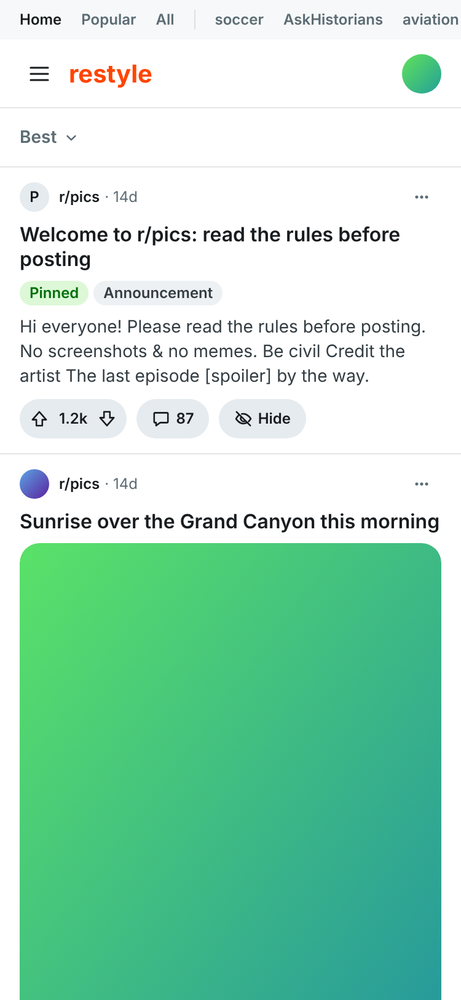
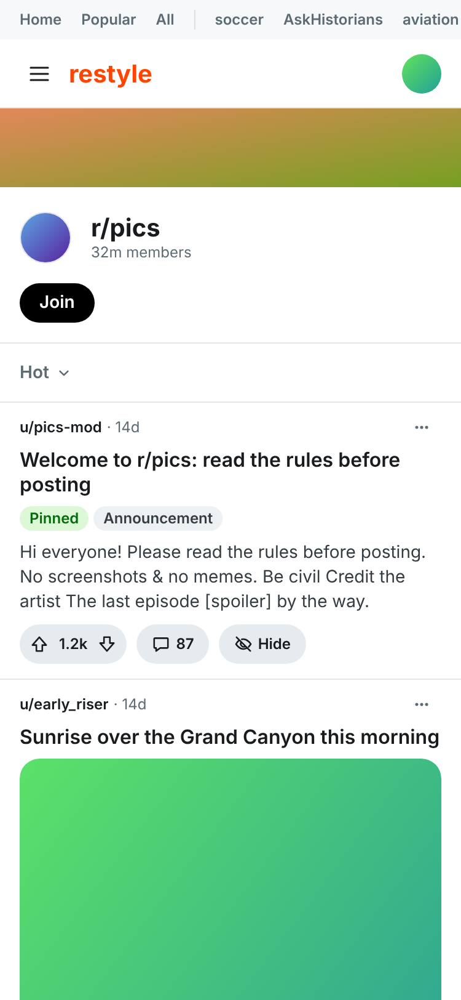
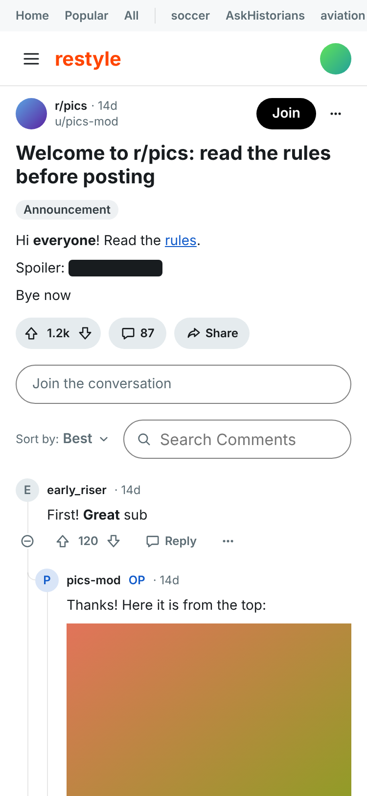
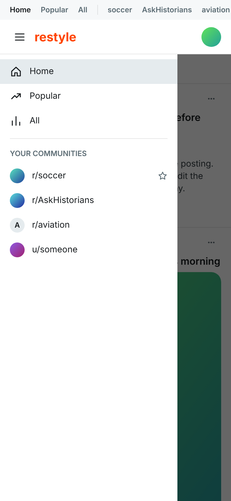
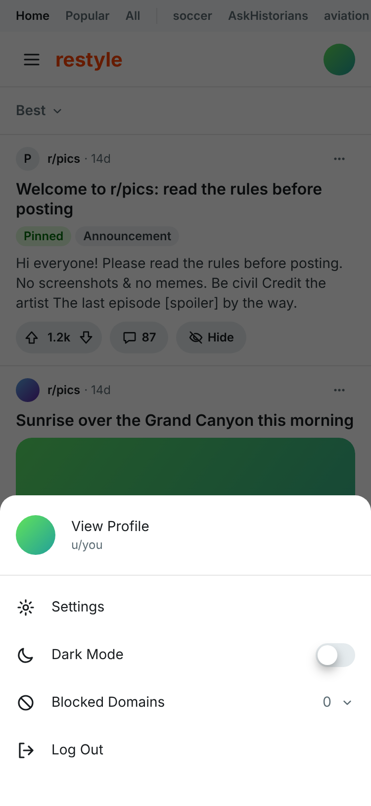
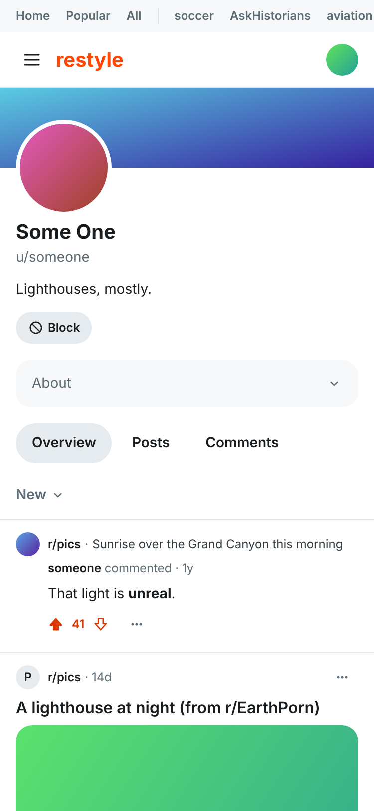
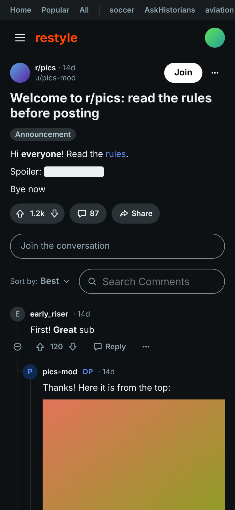
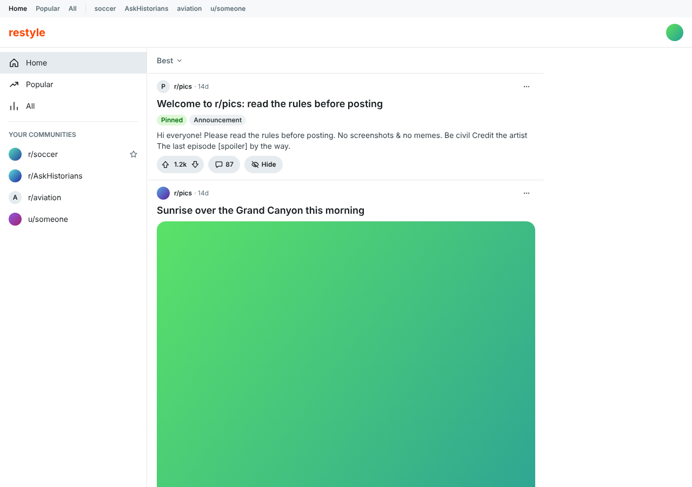

# Reddit Restyle

old.reddit.com, redrawn to look and feel like reddit.com's mobile site, as a
userscript for Safari on iPhone ([Userscripts](https://github.com/quoid/userscripts)).
It's built for an iPhone mini on iOS 16, and it also works on an iPad or a
computer's window.

You keep old reddit's speed and your account, and lose its desktop layout,
ads and trackers. Listings, posts and comments, and profiles are drawn from
reddit's own JSON, fetched as you. Voting, joining, commenting, hiding,
reporting and blocking all go through old reddit's API. Pages it doesn't
draw yet (settings, messages, search…) come up broken on purpose, so it's
obvious what's missing.

This is a personal project, shared as is. It isn't affiliated with reddit.

## Screenshots

Taken on the mock (`npm run screenshots`): made-up posts, people and
pictures from test/fixtures, signed in as a made-up u/you.

<table>
  <tr>
    <td></td>
    <td></td>
    <td></td>
  </tr>
  <tr>
    <td align="center">Front page</td>
    <td align="center">Subreddit</td>
    <td align="center">Post and comments</td>
  </tr>
  <tr>
    <td></td>
    <td></td>
    <td></td>
  </tr>
  <tr>
    <td align="center">Menu</td>
    <td align="center">Account</td>
    <td align="center">Profile</td>
  </tr>
  <tr>
    <td></td>
    <td colspan="2"></td>
  </tr>
  <tr>
    <td align="center">Dark mode</td>
    <td colspan="2" align="center">A computer's window (1280px)</td>
  </tr>
</table>

## What works

Everything here is old reddit's own JSON and API, called as you with your
cookies (no API key, no OAuth).

| Feature | Status | Reddit endpoint |
| --- | --- | --- |
| Front page, Popular, All, subreddits (one or several: r/pics+funny) | Works | `/[r/name/][sort/].json` |
| Sorts: Best, Hot, New, Top (with its span), Rising | Works | same, with `?t=` |
| More posts (next page in place) | Works | same, with `?after=` |
| Subreddit header: banner, icon, members | Works | `/r/name/about.json` |
| Join, leave | Works | `POST /api/subscribe` |
| Your communities (strip, menu, sidebar) | Works | `/subreddits/mine/subscriber.json` |
| Media in the feed: pictures, galleries, reddit videos, gifs, link cards | Works | from the listing |
| A post and its comments, a comment's thread | Works | `/comments/id/….json` |
| Comment sorts: Best, Top, New, Controversial, Old, Q&A | Works | same, with `?sort=` |
| "N more replies" | Works | `/api/morechildren.json` |
| Search comments (the ones loaded) | Works | none: on the page |
| Pictures and gifs in comments | Works | from the comment's links |
| Vote | Works | `POST /api/vote` |
| Comment, reply | Works | `POST /api/comment` |
| Hide, unhide a post | Works | `POST /api/hide`, `/api/unhide` |
| Report (by the subreddit's rules) | Works | `/r/name/about/rules.json`, `POST /api/report` |
| Block, unblock someone | Works | `POST /api/block_user`, `/api/unfriend` |
| Block a site (this device only) | Works | none: reddit keeps no such list |
| r/all filters: add, remove | Works | `/api/filter/user/you/f/all` (GET, PUT, DELETE) |
| Profiles: Overview, Posts, Comments; yours also Saved, Hidden, Upvoted, Downvoted | Works | `/user/name/about.json`, `/user/name/[tab]/.json` |
| Share | Works | none: the phone's share sheet |
| Dark mode | Works | none: this device, or your system's |
| Your account (name, avatar), log out | Works | `/api/me.json`, `POST /logout` |
| Save, unsave | Not yet | |
| Edit or delete your posts and comments | Not yet | |
| Posting (submit) | Not yet | |
| Search | Not yet (old reddit's page, broken) | |
| Messages, inbox, notifications | Not yet (old reddit's page, broken) | |
| Settings | Not yet (old reddit's page, broken) | |
| Moderation | Not planned | |

## Install

You need the free [Userscripts](https://github.com/quoid/userscripts)
app, turned on in Safari and allowed on old.reddit.com.

1. In Safari, open **https://alejandromaka.github.io/reddit-restyle/**.
2. Open each of the two scripts linked there, then tap **AA** (or the puzzle
   piece) → **Userscripts** → **Install**:
   - **reddit-restyle.user.js**: the restyle.
   - **reddit-blocker.user.js**: keeps old reddit's own scripts and stylesheets from loading.
3. Open old.reddit.com.

## Updating

Nothing updates on its own. When you open the Userscripts popup, it checks
whether a newer version is published and offers it. It installs only when
you tap **Update**.

## Privacy

There are no analytics, no API key and no server of ours. The script talks
only to reddit (as you, with your own cookies). The Userscripts app itself
checks GitHub Pages for updates when you open its popup. What you block or choose on this device (blocked sites,
dark mode) stays in Safari's storage for old.reddit.com.

## Development

```
npm run watch      # rebuild on every change (into the iCloud folder, if there is one)
npm run check      # typecheck, test, build
npm run bundle     # the build, plus what's published (dist/): reddit-restyle.user.js,
                   # reddit-blocker.user.js (with update URLs), index.html
npm run mock [path] # a WebKit iPhone mini on a mock old.reddit.com (fixtures), reloading on every build;
                    # MOCK_WIDTH=1280: a computer's window
npm run screenshots # the README's pictures (docs/screenshots/), on the mock; after a build
                    # (MOCK_BROWSER=chromium where there's no WebKit)
```

The build writes `Reddit Restyle.user.js`, which carries its own stylesheet,
and `Reddit Blocker.user.js` to dist/, and to the Userscripts app's iCloud
folder when that exists (`REDDIT_RESTYLE_OUT` picks another). Keep only
one copy of the restyle installed (the published one or the folder's): if
both are in, the first to start wins.

Every push to main publishes to GitHub Pages (.github/workflows/publish.yml;
Pages on, with GitHub Actions as its source). The published copies carry
`@updateURL`/`@downloadURL` (this repository's Pages, or
`REDDIT_RESTYLE_SITE`) and a version ending in the workflow's run number, so
each publish reads as newer to the Userscripts app.

### How it works

On the pages it owns, the script removes reddit's CSS and every reddit
script (ads and trackers with them) as the HTML parses, and draws the page
itself from reddit's own JSON: the same address with `.json` added, fetched
as you (your cookies), so your subscriptions and settings apply. No API key:
reddit closed self-service API access in November 2025.

Userscripts injects the script only after the HTML's head is parsed, too late
to stop what's there, so old reddit's own JS bundle and stylesheets are
blocked at the network instead (Reddit Blocker: Safari's
declarativeNetRequest, through Userscripts; rules in src/blocker.json, picked
up when a Safari window regains focus). Old reddit's own pages can't work
without them, on purpose: every page we don't draw yet comes up broken, so
what's missing shows. Nothing redirects, nothing falls back.

### Layout

```
src/
  main.ts            entry: shell → page set-up (at document start)
  blocker.json       network rules: old reddit's own scripts and CSS never load
  shell/
    pages.ts         owned pages, by path
    blocker.ts       takes over an owned page: reddit's CSS and scripts out,
                     the viewport fixed, our root in place of reddit's markup
  core/
    store.ts         createStore: a page's state (Preact draws from it)
    http.ts, text.ts, theme.ts (light or dark), domains.ts (sites you block)
    html.ts          reddit's rendered markdown, rebuilt safe, with our classes
  pages/<page>/      listing (the front page, subreddits), post (a post and its comments)
    contract.ts      reddit's requests and answers (its JSON), read into our
                     types
    types.ts         state and actions
    reducer.ts       pure: state + action → state
    effects.ts       network → actions
    index.tsx        set-up: the first request, then mount and draw
    views/           Preact components: our markup from the state (utility
                     classes); DOM events → actions
  account/           you on reddit (me.json: name, avatar, modhash); vote,
                     join, leave, comment, block, log out
  nav/               what every page shares: its frame (strip, bar, sidebar,
                     column), the menu, your account, your communities, and
                     their data (chrome.ts)
  components/        ours, reused anywhere (Preact): busy (the one loader),
                     icon, logo, avatar, sheet (slides over the page: the
                     menu, your account); ui.ts: recipes (utility bundles) and cx
  styles/            index.css @imports tokens → base → utilities; nested,
                     flattened by the build for iOS 16
    utilities.css    our markup's classes: Tailwind's names, rr- prefixed
test/                reducers as pure functions; contracts on saved JSON
                     (test/fixtures); pages in jsdom
docs/
  reddit-vars.json   www.reddit.com's CSS variables (light), where the tokens
                     come from; reddit-vars.js captures them again
```

### Pages

- **listing**: the front page, Popular, All and subreddits (several too:
  r/pics+funny), by sort (a dropdown: Best on the front page, Hot, New, Top
  with a second for its span, Rising). Under the bar, a subreddit's header
  as reddit.com has it: banner, icon, name and members (its about.json),
  with Join or Joined (tap to leave); wider than a phone, a taller rounded
  banner with a big icon over its edge and the name large; the front page,
  Popular, All and several subreddits at once have none. More posts loads
  the next page in place. Each post: its subreddit with its icon (a listing
  of several) or its author (one subreddit's), and its media, as
  reddit.com's feed: a video (reddit's own, or a gif) plays where it is
  (nothing of it loads until played); pictures (one, or a gallery to swipe
  through) open big when tapped (components/lightbox.tsx); a link's card
  opens the link (an outside video: ▶). Else its text's opening. NSFW too;
  none for spoilers. Only its title and its comments open its page: a tap
  anywhere else on it (its media, its text) doesn't.

What you do (vote, join, leave, block) shows at once and goes to old
reddit's own API as you (src/account: /api/vote, /api/subscribe,
/api/block_user, with your modhash from /api/me.json); one reddit refuses
goes back, and the console says why. Blocking someone (Block u/name in a
post's or comment's "…", or Block on their profile; asked first) turns
their posts into a line with Undo and folds their comments, marked Blocked
(as reddit says, too); Unblock is in the same places. Blocking a site (Block
site.com in a link post's "…") is this device's (core/domains.ts: reddit
keeps no such list): its posts, and its subdomains', turn into a line with
Undo, and from then on are left out; your account's Blocked Domains lists
them, each with Unblock.

- **post**: a post and its comments (or one comment's thread), as
  reddit.com's: where, when, who, Join; its title, tags and all of it (text,
  a gallery to swipe, a video Safari plays, a link); votes, comments, Share.
  Then "Join the conversation" (your comment), Sort by (a dropdown: Best,
  Top, New, Controversial, Old, Q&A) and Search Comments (the loaded ones),
  then the comments along their threads: votes, Reply (a box under it), ⊖
  to fold; "N more replies" loads them, a thread too deep continues on its
  own page. Text and comments are reddit's markdown, rebuilt safe
  (core/html.ts): spoilers stay hidden until tapped. A comment's link to a
  picture (reddit's own, or any https picture file) shows the picture in the
  comment, loaded only as it nears the screen (reddit's: a phone's width of
  it, its room kept before it comes); a tap opens it big. A gif with a video
  of itself (reddit's, Giphy's, imgur's .gifv: a fraction of the gif's size)
  is that video, muted and looping, loading and playing only while it's on
  screen (components/markdown.tsx); reddit's markdown for comment media, if
  old reddit leaves it as written (), shows it too.

On top, as old reddit has it, a strip: Home, Popular, All, then your
communities (favorites first, A–Z, fetched alongside the page's posts), side
by side, swiped for more; it scrolls away. Under it the bar, which stays, as
reddit.com's: ☰ slides in the menu under it (the same, as a list; ☰ again
closes it), our wordmark ("restyle", not reddit's logo) goes home, and your avatar opens your account
(a sheet from the bottom on a phone, a dropdown on a wide screen): View
Profile and Settings (old reddit's pages, which break until we build them),
Dark Mode (this device remembers it; else your system's), Blocked Domains,
Log Out. The page
is a column (732px, as reddit.com's) centered in the window; on a screen
1024px and up (an iPad mini across, 1133px) the menu is also a sidebar,
always there, at the left edge: from 1280px over the column's margin, and
narrower the column moves over beside it.

### Rules

- Styles: utility classes only (`rr-` prefix, Tailwind's names), values from
  tokens; bundles that repeat are recipes in components/ui.ts. No component
  or BEM classes, no IDs in our markup.
- Look: www.reddit.com's own. Tokens take its values under its variable
  names (docs/reddit-vars.json), so colors read `rr-text-neutral-content-weak`,
  `rr-bg-secondary-background`, as reddit's do.
- Views: Preact, written as if eslint-plugin-react and react-hooks were on:
  stable keys, complete effect dependencies, no components inside
  components, children and compound components over components as props.
- One loader: components/busy (a ring in reddit's loader color).
- Keep it personal: no bulk fetching, no automated actions.
